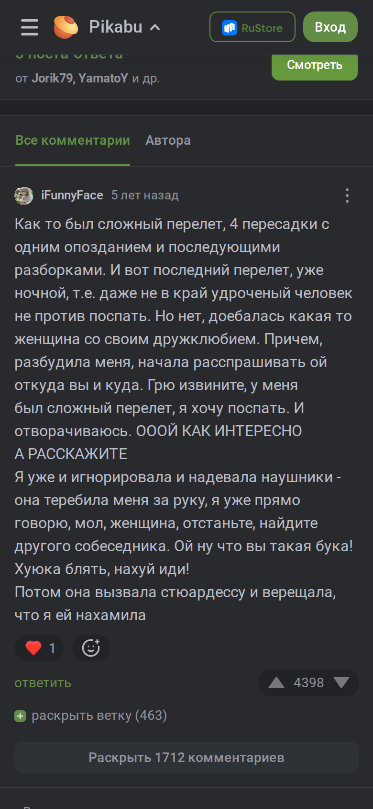
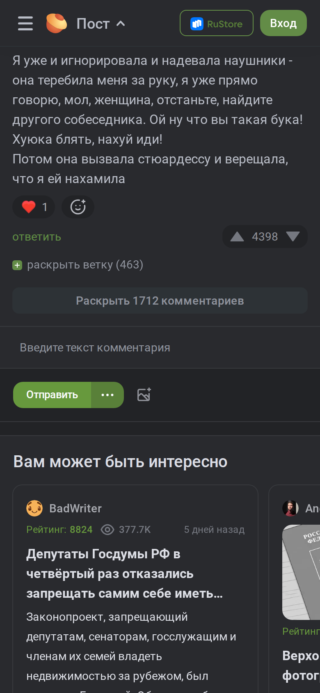

# Mobile Pikabu Post Page DOM, Routing, Themes, and Comment-Loading Behavior

**Research Date:** 2026-11-23
**Resolves:** Wayfinder Research Ticket [#30](https://github.com/lolmaus/pikabu-expand-comments/issues/30) (Map [#29](https://github.com/lolmaus/pikabu-expand-comments/issues/29))
**Builds On:** Desktop Post Page findings in [`docs/research/pikabu-dom.md`](https://github.com/lolmaus/pikabu-expand-comments/blob/research/pikabu-dom/docs/research/pikabu-dom.md) and [`docs/research/pikabu-ui-dom.md`](https://github.com/lolmaus/pikabu-expand-comments/blob/research/pikabu-ui-dom/docs/research/pikabu-ui-dom.md)

## Primary Sources Inspected Live

All routing checks, DOM trees, hydration timings, CSS rules, token diffs, and screenshots were gathered directly from live mobile Pikabu.ru Post Pages using headless Playwright Chromium (`chromiumSandbox: false` / `--no-sandbox`, `locale: "ru-RU"`, logged-out, Android 14 Chrome Mobile UA `Pixel 7` and Android 14 Firefox Mobile UA, viewports `390×844` and `412×915`):

1. `https://pikabu.ru/story/poputchik_7957162` & `https://m.pikabu.ru/story/poputchik_7957162` ("Попутчик - 14.01.21 11:38 | Пикабу", 1,710 reported / 1,713 tree comments, collapsed Comment Batches, deep Reply Branches with `next-floor` and `only-hidden` variants, 4 Author comment threads) — inspected on `«Все комментарии»`, SPA-switched `«Автора»`, and direct SSR `https://pikabu.ru/story/poputchik_7957162/author`.
2. `https://pikabu.ru/story/pupupu_14554208` (active front-page post, 418 reported comments, 0 Author comments).
3. `https://pikabu.ru/story/memoterapiya_podekhala_a_to_chto_to_davno_ne_byilo_14551680` (144 reported comments, verified at `412×915`).
4. `https://pikabu.ru/story/ochen_priyatno_14551884` (0 Author comments — verified disabled `«Автора»` tab state on mobile).
5. First-party stylesheets compared byte-for-byte on CSS custom properties:
   - Mobile: `https://cs.pikabu.ru/apps/ub/5.4.1088/mobile/app.css` (696 KB)
   - Desktop: `https://cs.pikabu.ru/apps/ub/5.4.1088/desktop/app.css` (689 KB)

---

## 1. URL, Host, and Desktop/Mobile View-Switching Behavior

### 1.1 `m.pikabu.ru` vs. `pikabu.ru` & Server-Side UA Detection

Pikabu does **not** serve Post Pages on `m.pikabu.ru`. Instead, `m.pikabu.ru` permanently redirects to `pikabu.ru`, and `pikabu.ru` serves either the mobile (`mv`) or desktop (`dv`) HTML/CSS bundle based on **server-side User-Agent detection** (not viewport width):

| Probe                         | Requested URL                                 | HTTP Chain  | Final URL                                   | `<html class>` | Stylesheet Loaded     | `scrollWidth` |
| ----------------------------- | --------------------------------------------- | ----------- | ------------------------------------------- | -------------- | --------------------- | ------------- |
| Android Chrome UA, `390×844`  | `https://pikabu.ru/story/poputchik_7957162`   | `200`       | `https://pikabu.ru/story/poputchik_7957162` | `mv`           | `.../mobile/app.css`  | `390`         |
| Android Chrome UA, `412×915`  | `https://m.pikabu.ru/story/poputchik_7957162` | `301 → 200` | `https://pikabu.ru/story/poputchik_7957162` | `mv`           | `.../mobile/app.css`  | `412`         |
| Android Firefox UA, `390×844` | `https://pikabu.ru/story/poputchik_7957162`   | `200`       | `https://pikabu.ru/story/poputchik_7957162` | `mv`           | `.../mobile/app.css`  | `390`         |
| Android Chrome UA, `1280×900` | `https://pikabu.ru/story/poputchik_7957162`   | `200`       | `https://pikabu.ru/story/poputchik_7957162` | `mv`           | `.../mobile/app.css`  | `1280`        |
| Desktop Chrome UA, `390×844`  | `https://pikabu.ru/story/poputchik_7957162`   | `200`       | `https://pikabu.ru/story/poputchik_7957162` | `dv`           | `.../desktop/app.css` | `900`         |
| Desktop Chrome UA, `1280×900` | `https://m.pikabu.ru/story/poputchik_7957162` | `301 → 200` | `https://pikabu.ru/story/poputchik_7957162` | `dv`           | `.../desktop/app.css` | `1280`        |

**Response headers observed on mobile `https://pikabu.ru/story/poputchik_7957162`:**

- `server: ddos-guard`
- `content-type: text/html; charset=windows-1251`
- `content-security-policy: upgrade-insecure-requests, frame-ancestors *.pikabu.ru pikabu.ru` (identical to desktop — no `script-src`, `style-src`, or Trusted Types blocks)
- `vary: Accept-Encoding`

### 1.2 Desktop ↔ Mobile View Switching

- **No in-page switcher link in logged-out UI:** Neither the mobile hamburger drawer (including all expanded footer accordions: `О нас`, `Информация`, `Наши проекты`, `Партнёры`) nor the desktop Post Page renders a visible "Полная версия" / "Мобильная версия" link.
- **Query-parameter + cookie override (`?dv=1` / `?mv=1`):**
  - On a **mobile UA**, navigating to `?dv=1` switches to desktop view (`<html class="dv">` + `desktop/app.css`) and sets cookie **`display_desktop=1`**, so subsequent clean `/story/...` navigations remain on `dv`.
  - Navigating to `?mv=1` on a **mobile UA** sets **`display_desktop=0`** and restores mobile view (`<html class="mv">` + `mobile/app.css`).
  - `?desktop=1` and `?mobile=0` have no effect.
  - On a **desktop UA**, `?mv=1` is ignored (`<html class="dv">` is still served).
- **Browser-native "Desktop site" toggle:** Changes the browser's `User-Agent` to a desktop UA, causing Pikabu to serve `dv`.

### 1.3 Implications for Matching & Detection

- Existing userscript metadata (`@match https://pikabu.ru/story/*`) and runtime origin check (`location.origin === "https://pikabu.ru"`) **already cover mobile Pikabu** because `m.pikabu.ru` redirects with HTTP `301` before document execution.
- `document.documentElement.classList.contains("mv")` is an authoritative, first-party runtime signal for Pikabu's mobile template (`mv` vs. `dv`). Pair it with responsive width handling so narrow desktop viewports and wide mobile/tablet `mv` viewports both behave cleanly.

---

## 2. Comment DOM, Loaders, and Hydration Behavior

### 2.1 Shared Architecture vs. Mobile-Specific Differences

Mobile Pikabu reuses the **same comment-tree JSON manifest, backend endpoint, and core loader selectors** as desktop, with four important differences:

| Aspect                                                 | Desktop (`dv`)                                                           | Mobile (`mv`)                                                                                                                                                                                                              | Impact on `src/adapters/pikabu/post-page.ts`                                                                                               |
| ------------------------------------------------------ | ------------------------------------------------------------------------ | -------------------------------------------------------------------------------------------------------------------------------------------------------------------------------------------------------------------------- | ------------------------------------------------------------------------------------------------------------------------------------------ |
| Embedded tree manifest                                 | `<script type="application/json" data-entry="comments-tree">`            | Identical, inside `.story-comments__all > section.comments`                                                                                                                                                                | None (not coupled to internals)                                                                                                            |
| Hydration API                                          | `POST /ajax/comments_actions.php` (`action=get_comments_by_ids&ids=...`) | Identical                                                                                                                                                                                                                  | None                                                                                                                                       |
| Initial SSR `.comment` nodes in `.comments__container` | `1` visible (`0` hidden)                                                 | **`5` DOM nodes: `1` visible + `4` with `hidden` attribute** (verified across all 3 stories)                                                                                                                               | Existing `!element.closest("[hidden]")` filter keeps initial `loadedCommentsCount === 1`                                                   |
| Comment Batch size (`.comment__more`)                  | `+40` top-level comments/click                                           | **`+24` top-level comments/click** (unhides the `4` SSR comments + fetches `20` via XHR)                                                                                                                                   | Works automatically                                                                                                                        |
| Loading placeholder classes                            | `.comment_loading-hidden` on batch & branch                              | Batch: `19` `.comment_placeholder.comment_loading-hidden` + `1` `.comment_placeholder`. **Reply Branch: `.comment_placeholder` + `<div class="comment__placeholder">` SVG skeleton ONLY (`0` `.comment_loading-hidden`!)** | Existing `placeholder` selector already includes `.comment_placeholder, .comment:has(> .comment__placeholder)` — **must never drop these** |
| Deep nesting (`next-floor`) threshold                  | `data-indent="10"`                                                       | **`data-indent="6"`** (resets child `data-indent` to `"1"` inside `.comment__children.comment__children_next-floor`)                                                                                                       | Works automatically via `.comment-toggle-children.comment-toggle-children_collapse`                                                        |
| Initial SSR toggle element tag                         | `<a>` on SSR, `<div>` on dynamic                                         | `<div>` even on initial SSR                                                                                                                                                                                                | Already tag-agnostic                                                                                                                       |

### 2.2 Live Bounded Click Verification (`poputchik_7957162`, `390×844`)

All loader clicks below were triggered via DOM `element.click()` (matching userscript behavior):

1. **Initial state:** `5` total `.comment` nodes (`1` visible, `4` `[hidden]`), `1` visible collapsed Reply Branch (`раскрыть ветку (463)` on `comment_189851078`), `button.comment__more` reading `Раскрыть 1712 комментариев`.
2. **Click 1 — Comment Batch (`.comment__more`):**
   - At `30 ms`: `totalDom: 25`, `hiddenDom: 0`, `hydrated: 5` (the 4 pre-rendered comments unhid synchronously), `phClass: 20` (`19` also `.comment_loading-hidden`), `.comment__more` updated synchronously to `Раскрыть 560 комментариев`.
   - Network: `POST https://pikabu.ru/ajax/comments_actions.php` (`action=get_comments_by_ids` with 20 IDs, HTTP 200, `119 KB` JSON).
   - Settled (`2.5 s`): `25` visible hydrated `.comment` nodes, `0` placeholders, `0` `.comment_loading-hidden`, `19` collapsed Reply Branches. `scrollY` remained `1430`.
3. **Click 2 — Large Standard Reply Branch (`comment_189851078`, `раскрыть ветку (463)`):**
   - At `50 ms`: `349` visible `.comment` nodes (`25` hydrated + **`324` `.comment.comment_placeholder`**, **`0` `.comment_loading-hidden`**). Placeholder markup:
     ```html
     <div
       class="comment comment_placeholder"
       id="comment_189861327"
       data-id="189861327"
       data-indent="1"
     >
       <div class="comment__placeholder">
         <svg height="100" width="400" viewBox="0 0 400 100">...</svg>
       </div>
     </div>
     ```
   - Network: single `POST https://pikabu.ru/ajax/comments_actions.php` (`HTTP 200`, `1.53 MB` JSON).
   - Settled **without scrolling** (`1.5 s`): `325` visible hydrated `.comment` nodes (24 pruned/deleted placeholders removed on hydration), `0` placeholders, `0` `.comment_loading-hidden`, `37` collapsed Reply Branches (`17` `next-floor` at `data-indent="6"`, `2` `only-hidden`). Subsequent scrolls over the branch fired **zero** additional XHRs — confirming **no lazy scroll-triggered hydration** is required on mobile.
   - Note from `mobile/app.css`: `.comment_placeholder > .comment-toggle-children { visibility: hidden }`. Waiting for placeholders to finish hydrating before clicking nested loaders is mandatory.
4. **Click 3 — Next-Floor Reply Branch (`comment_189961424`, `data-indent="6"`, `раскрыть ветку (5)`):**
   - Classes before: `comment-toggle-children comment-toggle-children_next-floor comment-toggle-children_collapse`.
   - Network: `POST /ajax/comments_actions.php` with 5 IDs (`HTTP 200`, `34 KB`).
   - After: `_collapse` stripped (`comment-toggle-children comment-toggle-children_next-floor`), sibling `<div class="comment__children comment__children_next-floor">` unhidden (`hidden: false`), 5 hydrated child comments with reset indents (`1, 1, 2, 3, 1`).
5. **Click 4 — Only-Hidden Reply Branch (`comment_189854783`, `data-indent="3"`, `ещё комментарии`):**
   - Classes before: `comment-toggle-children comment-toggle-children_only-hidden comment-toggle-children_collapse`.
   - Network: `POST /ajax/comments_actions.php` with 5 IDs (`HTTP 200`, `33 KB`).
   - After: `_collapse` stripped, `.comment__children` unhidden, 5 comments hydrated (starting with a `DELETED` comment and its replies).
6. **Manual collapse controls on mobile:**
   - Expanded branches retain `.comment-toggle-children` (without `_collapse`), `.comment__collapsing-area` (`position: absolute; width: 25px; height: 100%; left: -10px; top: 0`), and `.comment__close-branch` (`width: 30px; height: 30px; bottom: -15px`) on `next-floor` branches.
   - **Subtlety:** Mobile collapse handlers can apply `_collapse` / `hidden` asynchronously after click (not always synchronously in the same JS tick), so `observeManualCollapses` capturing click events on `.comment-toggle-children:not(.comment-toggle-children_collapse)`, `.comment__collapsing-area`, and `.comment__close-branch` remains the right design.

---

## 3. Metadata, Tabs, Sorting, and Layout Landmarks

### 3.1 Total Comment Count DOM Sources

All public comment-count sources match desktop identically:

| Source                       | Selector                                              | `poputchik_7957162`                          | `pupupu_14554208`    | `memoterapiya_14551680` | Updates on `Автора` Tab? |
| ---------------------------- | ----------------------------------------------------- | -------------------------------------------- | -------------------- | ----------------------- | ------------------------ |
| Story root attribute         | `article.story[data-comments]`                        | `"1710"`                                     | `"418"`              | `"144"`                 | No (story-wide)          |
| Story footer link counter    | `.story__comments-link-count`                         | `"1710"`                                     | `"418"`              | `"144"`                 | No (story-wide)          |
| Batch button remaining count | `.comments__more-count`                               | `"1712 комментариев"` (+1 visible = `1713`)  | `"417 комментариев"` | `"143 комментария"`     | Removed on `Автора`      |
| Author thread wrappers       | `.story-comments__author [data-story-comments-count]` | `"1710"` (story total, **not** author count) | N/A                  | N/A                     | Always story-wide        |

### 3.2 Comment Tabs, Sorting, and SPA Routing

- **No comment sorting UI:** Mobile Pikabu has no comment sort control (verified in live DOM across 4 stories and `0` comment-sort rules in `mobile/app.css`).
- **Tab bar markup (`.story-comments__menu`):**
  ```html
  <section class="story-comments__menu section_header">
    <div class="menu menu_horizontal menu_draggable">
      <a
        data-id="all"
        data-analytics-type="all"
        class="menu__item menu__item_route menu__item_current"
        href="/story/poputchik_7957162#comments"
        data-route="/story/poputchik_7957162"
        >Все комментарии</a
      >
      <a
        data-id="author"
        data-analytics-type="by_author"
        class="menu__item menu__item_route"
        href="/story/poputchik_7957162/author#comments"
        data-route="/story/poputchik_7957162/author"
        >Автора</a
      >
      <div class="menu__spinner" style="display: none;">...</div>
    </div>
  </section>
  ```
  - On posts with 0 author comments (`pupupu_14554208`, `ochen_priyatno_14551884`), `a[data-id="author"]` receives `menu__item_disabled`.
  - **SPA switching works identically to desktop:** Clicking `Автора` navigates to `/story/<slug>/author#comments`, hides `.story-comments__all`, shows `.story-comments__author` (`4` `.comments__container` blocks / `8` comments / `2` collapsed loaders on `poputchik_7957162`), and moves `.menu__item_current`. Returning to `Все комментарии` restores `/story/<slug>#comments` and keeps previously expanded comments (`325` retained). Direct SSR `/story/<slug>/author` renders `.story-comments__author` directly.

### 3.3 Exact Mobile Comments DOM Hierarchy & Safe Mounting Points

```html
<div class="page-story__wrapper">
  <main><!-- article.story --></main>
  <div class="page-story__before-comments"><!-- answer posts / ad slot --></div>
  <div class="story-comments section-group">
    <section class="story-comments__menu section_header">
      <!-- 390×54 (or 412×54), padding: 0 16px, overflow-x: hidden -->
      <div class="menu menu_horizontal menu_draggable"><!-- width: 210px --></div>
    </section>
    <div class="story-comments__all section-group">
      <section class="comments">
        <!-- padding: 15px, bg: var(--color-bright-800) -->
        <script type="application/json" data-entry="comments-tree">
          ...
        </script>
        <div class="comments__container"><!-- width: 360px at 390px / 382px at 412px --></div>
      </section>
    </div>
    <section class="story-comments__author comments-part"></section>
    <section class="story-comments__hidden comments-part"></section>
  </div>
  <section data-role="answer" class="page-story__answer section_padding_none">
    <!-- Lazy-hydrated comment form: 2px tall before hydration -> 117px tall after -->
  </section>
  <section class="story-page-related-carousel carousel"
    ><!-- "Вам может быть интересно" --></section
  >
  <div class="page-story__under-comments ads-placeholder"></div>
  <div class="related-stories-feed"></div>
</div>
```

**Mounting-point constraints (CRITICAL for mobile UI design):**

1. **Top control — DO NOT squeeze inline into `.story-comments__menu` on narrow mobile widths:**
   - `.story-comments__menu` is `display: flex; align-items: center; justify-content: space-between; padding: 0 16px; overflow-x: hidden; height: 54px`.
   - The native tabs (`.menu.menu_horizontal.menu_draggable`) already occupy **`210px`**, leaving only **`148px`** at `390px` viewport width (`390 - 32 - 210`) and **`170px`** at `412px`!
   - Appending our current inline top control (action button + counter + scroll-to-bottom + settings with `44px` touch targets) inside `.story-comments__menu` will overflow, clip, or force `.story-comments__menu` taller (breaking tab baseline/underline alignment).
   - **Recommended safe top mount point on mobile (`mv`):** Insert a dedicated full-width companion strip **as a direct sibling immediately after `.story-comments__menu`** inside `.story-comments.section-group` (above `.story-comments__all` / `.story-comments__author`), styled with `background: var(--color-bright-800)`, `border-bottom: 1px solid var(--color-black-430)`, and `padding: 8px 16px`. This leaves `.story-comments__menu` 100% undistorted (`54px` tall, zero tab-underline shift) while giving the top control the full `358px` (`390px`) or `380px` (`412px`) inner width.
2. **Bottom control — `view.container.after(host)` (and `.story-comments__author.append(host)`) is already safe:**
   - Inside `<section class="comments">` (`padding: 15px`, `background: var(--color-bright-800)`), `.comments__container` is `360px` wide at `390px` (`382px` at `412px`), and `button.comment__more` is `360×32px`. Mounting immediately after `.comments__container` sits cleanly between `.comment__more` (or the last comment) and `section[data-role="answer"]`.
3. **Scroll-to-bottom target (`section[data-role="answer"]`):**
   - Present on mobile (`<section data-role="answer" class="page-story__answer section_padding_none">`) as the next sibling after `.story-comments`.
   - **Quirk:** Before scrolling/JS hydration, it is empty (`height: 2px`), then hydrates into the `117px` tall comment composer (`Введите текст комментария` + `Отправить`). In PWA/KMP shells (`.pwa .page-story__answer`), CSS makes it `position: sticky; bottom: -1px; z-index: 6000`. Existing `findScrollToBottomTarget` matches it cleanly in both states, though scrolling with `block: "center"` avoids placing it behind bottom sticky ads or the top sticky header.

### 3.4 Sticky Headers, Fixed Bottom Chrome, and Scroll-Preservation Quirks

Mobile Pikabu has a dynamic multi-layer sticky/fixed chrome stack that directly impacts scroll anchoring, floating-stop visibility, and z-index layering:

| Element                         | Selector                                          | Position & Size                                                                                     | `z-index`    | Behavior on Scroll                                                                                             |
| ------------------------------- | ------------------------------------------------- | --------------------------------------------------------------------------------------------------- | ------------ | -------------------------------------------------------------------------------------------------------------- |
| App install banner              | `.smartbanner.smartbanner--android`               | Static flow, `72px` tall                                                                            | `auto`       | Scrolls away normally; dismissible via `.smartbanner__exit`                                                    |
| Sticky promo banner             | `.promo-banner.promo-banner_button`               | `position: sticky; top: 0` (`56px` tall)                                                            | `5001`       | Slides out (`top: -56px`) when `.promo-banner-sticky_visible` is removed on scroll down                        |
| Sticky top header               | `header.header`                                   | `position: sticky; top: 56px` → `0` (`56px` tall)                                                   | `5001`       | Always visible (`56px` occlusion scrolling down; `112px` combined with promo banner)                           |
| Feed tab bar                    | `.pkb-tab-list.header-tab-list`                   | `position: sticky; top: 0` → `56px` (`49px` tall)                                                   | `5000`       | Tucked behind `header` on scroll down; slides out (`top: 56px`) on scroll UP (**`105px` total top occlusion**) |
| Floating story action bar       | `.story-action-bar`                               | `position: fixed; left: 50%; bottom: max(16px + var(--bottom-offset), env(safe-area-inset-bottom))` | `6001`       | Hidden via `.story-action-bar_hidden` or `.floor-ad-shown .story-action-bar { display: none }`                 |
| Toasts container                | `.toasts`                                         | `position: fixed; top: 56px`                                                                        | `10000`      | Above header                                                                                                   |
| Mobile nav drawer               | `.app__host--*` (opened by `button.header__menu`) | `position: fixed; inset: 0`                                                                         | `10001`      | Fullscreen overlay                                                                                             |
| Third-party Yandex RTB floor ad | Dynamic (e.g., `.WfSayC.phV4sd`)                  | `position: fixed; bottom: 0` (observed up to **`219px` tall** on `390×844`!)                        | `2147483647` | Appears when ads are unblocked; can obscure bottom-pinned UI                                                   |

**Three concrete mobile bugs/risks in current desktop code (`src/`):**

1. **`scroll-preservation.ts` anchor probe (`y = 0`):** `capture()` calls `document.elementsFromPoint((left + right) / 2, 0)`. On mobile, `y = 0` sits **behind** the `56px–112px` sticky header, so it anchors a comment the reader cannot see instead of the comment visible just below `header.header` (`header.getBoundingClientRect().bottom` or `~headerBottom + 8px`).
2. **`expansion-control.ts` floating-stop threshold (`rectBottom <= 0`):** `updateShortcut()` waits until `top.host.getBoundingClientRect().bottom <= 0`, whereas on mobile the top bar disappears behind `header.header` as soon as `rectBottom <= headerBottom` (`56px–112px`).
3. **`.floating-stop` & fallback popover `z-index: 1000` + bottom collision:**
   - Current `z-index: 1000` sits **underneath** `header.header` (`5001`) and `.story-action-bar` (`6001`). Popovers using native `popover="auto"` promote to the browser top layer (safe), but `.floating-stop` does not — it needs a z-index above `6001` (or safe horizontal/vertical offset from `.story-action-bar` and bottom safe-area) if kept as a bottom-right floating pill.

---

## 4. Themes, CSS Tokens, and Verification / Playwright Quirks

### 4.1 CSS Custom Property Parity (Mobile vs. Desktop)

Automated diffing of every CSS custom property in `mobile/app.css` vs. `desktop/app.css` confirmed **100% parity (0 differences)** across all three token blocks:

- `:root` (light palette & shadows): **190 / 190 identical**
- `.ui-kit-theme_pika-day, html` (UI-kit light tokens): **739 / 739 identical**
- `html[data-theme-dark]` / `.ui-kit-theme_pika-night` (dark palette + UI-kit dark tokens): **903 / 903 identical**

All 15 tokens consumed by `src/ui/expansion-control.ts` resolve identically on live mobile Pikabu:

| Token                         | Light (`:root` / `html`)           | Dark (`html[data-theme-dark]`)     |
| ----------------------------- | ---------------------------------- | ---------------------------------- |
| `--color-black-940`           | `#1b1e24`                          | `#e0e3ea`                          |
| `--color-black-800`           | `#444850`                          | `#b9bdc7`                          |
| `--color-black-440`           | `#e7e8ea`                          | `#2d3236`                          |
| `--color-black-430`           | `#ebedf2`                          | `#37393d`                          |
| `--color-black-300`           | `#f7f8fc`                          | `#222326`                          |
| `--color-bright-800`          | `#fcfdff`                          | `#292a2e`                          |
| `--color-primary-900`         | `#65ab3c`                          | `#618f45`                          |
| `--color-danger-800`          | `#f75c48`                          | `#ca4533`                          |
| `--color-black-alpha-16`      | `rgba(33, 33, 33, 0.16)`           | `rgba(33, 33, 33, 0.46)`           |
| `--c-btn-secondary-bgDefault` | `#dcdee5`                          | `#45474d`                          |
| `--c-btn-secondary-bgHover`   | `#ced1d9`                          | `#5e6066`                          |
| `--c-btnIcon-primary-bgHover` | `rgba(31, 32, 33, 0.08)`           | `rgba(255, 255, 255, 0.08)`        |
| `--c-btnIcon-primary-bgClick` | `rgba(31, 32, 33, 0.16)`           | `rgba(255, 255, 255, 0.16)`        |
| `--s-gap-blocks`              | `1rem` (`16px`)                    | `1rem` (`16px`)                    |
| `--shadow-medium`             | `0 4px 20px 0 rgba(0, 0, 0, 0.08)` | `0 4px 20px 0 rgba(0, 0, 0, 0.24)` |

### 4.2 How Mobile Pikabu Applies Dark Mode

- `mobile/app.css` contains **zero** `@media (prefers-color-scheme: dark)` rules; dark styling is driven strictly by `html[data-theme-dark]`.
- However, Pikabu's client-side JS **automatically detects `prefers-color-scheme: dark`** on first visit: launching a fresh Playwright mobile context with `colorScheme: "dark"` sets `<html lang="ru" class="mv" dir="ltr" data-theme-dark="true">` and persists `localStorage["pkb_theme"] = '{"t":"default","d":true,"a":true,"s":false,"f":null,"to":null,"v":1}'`.
- Manual theme controls live in the mobile hamburger drawer (`button.header__menu` → `Оформление`): switches for `Микроанимации`, `Ночная тема`, and `Применять тему автоматически` (with optional `с` / `до` time inputs).

### 4.3 Anti-Bot, Ads, and Playwright Fixture / Smoke-Test Quirks

1. **No CAPTCHA or anti-bot blocking:** Headless Chromium with Android Chrome and Android Firefox UAs loaded all tested Post Pages (`HTTP 200`, `server: ddos-guard`) and hydrated comment XHRs cleanly without challenges.
2. **Mobile UA is mandatory for live mobile smoke tests:** Because Pikabu switches `mv` vs. `dv` strictly by `User-Agent`, mobile Playwright projects must set a mobile `userAgent` (in addition to `viewport`, `hasTouch: true`, `isMobile: true`).
3. **Unblocked third-party ads cause intermittent overlays & `body { overflow: hidden }`:**
   - Unblocked mobile loads intermittently inject a fixed bottom Yandex RTB floor ad (`z-index: 2147483647`, up to `219px` tall) and occasionally set `document.body.style.overflow = "hidden"` via fullscreen promo/ad overlays.
   - Coordinate-based Playwright `locator.click()` (even with `{ force: true }`) can be intercepted by these overlays, whereas DOM `el.click()` (used by our userscript) is unaffected.
   - **Test recommendation:** Live mobile smoke tests and visual captures should either abort third-party ad requests (allowing `pikabu.ru`, `*.pikabu.ru`, `*.pikabu.tech`) or trigger userscript controls via DOM `.click()` (as `tests/live/userscript.spec.ts` already does on desktop).
4. **Mobile visual fixtures (`tests/fixtures/`):**
   - Existing `tests/fixtures/pikabu-theme.css` already matches mobile's light/dark CSS tokens.
   - A mobile fixture variant should add `<html class="mv">`, `.story-comments__menu` with `padding: 0 16px; overflow-x: hidden; height: 54px` and `.menu.menu_horizontal.menu_draggable` (`210px`), `section.comments` with `padding: 15px`, a `56px` sticky `header.header` (`z-index: 5001`), optional `56px` `.promo-banner`, and test viewports `390×844` and `412×915`.

---

## 5. Visual Reference Screenshots (Real Mobile Pikabu, `390×844`)

Captured live on `https://pikabu.ru/story/poputchik_7957162` with Android 14 Pixel 7 UA (first-party Pikabu hosts only so native chrome and comment layout are unobstructed):

| View                                                                                                  | Light Theme                                                                            | Dark Theme (`data-theme-dark="true"`)                                                |
| ----------------------------------------------------------------------------------------------------- | -------------------------------------------------------------------------------------- | ------------------------------------------------------------------------------------ |
| Top comments header (`.story-comments__menu`), first comment, Reply Branch loader, & `.comment__more` |    |    |
| Bottom `.comment__more`, hydrated `section[data-role="answer"]` composer, & related stories carousel  |  |  |
