# Pikabu UI DOM Inspection: Total Comment Count, Tab Bar CSS, and Bottom Comment Loader

**Research Date:** 2026-11-22
**Resolves:** Wayfinder Research Ticket [#19](https://github.com/lolmaus/pikabu-expand-comments/issues/19) (Map [#17](https://github.com/lolmaus/pikabu-expand-comments/issues/17))
**Builds On:** Prior comment-loader DOM findings in [`docs/research/pikabu-dom.md`](https://github.com/lolmaus/pikabu-expand-comments/blob/research/pikabu-dom/docs/research/pikabu-dom.md)

## Primary Sources Inspected Live

All measurements, DOM snippets, CSS rules, and screenshots were gathered directly from live desktop Pikabu.ru Post Pages using headless Playwright Chromium (`1280×900`, `locale: "ru-RU"`, logged-out, `chromiumSandbox: false`, no CAPTCHA/anti-bot encountered, HTTP 200 on all requests):

1. `https://pikabu.ru/story/poputchik_7957162` ("Попутчик", 5-year-old post with 1,710 reported / 1,713 tree comments, collapsed Comment Batches, collapsed Reply Branches, deleted/hidden comments, and 4 Author comment threads) — inspected on default `«Все комментарии»`, SPA-switched `«Автора»`, and direct SSR `https://pikabu.ru/story/poputchik_7957162/author`, both bare and with built userscript `v0.1.8` (`dist/userscript/pikabu-expand-comments.user.js`).
2. `https://pikabu.ru/story/memoterapiya_podekhala_a_to_chto_to_davno_ne_byilo_14551680` ("Мемотерапия подъехала…", 97 comments, collapsed Comment Batch + 12 collapsed Reply Branches + 7 Author comment threads) — fully expanded end-to-end (1 batch click + 12 sequential branch clicks) to verify exact post-expansion counts and bottom-of-comments DOM states.
3. `https://pikabu.ru/story/ochen_priyatno_14551884` (84 comments, 0 Author comments) — verified disabled `«Автора»` tab state (`menu__item_disabled`).
4. Pikabu desktop stylesheet: `https://cs.pikabu.ru/apps/ub/5.4.1088/desktop/app.css`.

---

## 1. Total Comment Count in the Public DOM

### 1.1 Every Public DOM Location Reporting Comment Counts

| Location                                                                   | Selector                                                                           | Tab Scope                                              | Example Value (`poputchik_7957162`)                          | Example Value (`memoterapiya_14551680`)                      | Updates on SPA Tab Switch?                                          |
| -------------------------------------------------------------------------- | ---------------------------------------------------------------------------------- | ------------------------------------------------------ | ------------------------------------------------------------ | ------------------------------------------------------------ | ------------------------------------------------------------------- |
| Story root attribute                                                       | `article.story[data-comments]`                                                     | Story-wide (`Все комментарии`)                         | `"1710"`                                                     | `"97"`                                                       | **No** (stays `"1710"` / `"97"`)                                    |
| Story footer comment link                                                  | `.story__footer .story__comments-link-count`                                       | Story-wide (`Все комментарии`)                         | `"1710"`                                                     | `"97"`                                                       | **No** (stays `"1710"` / `"97"`)                                    |
| Comment Batch button (remaining unrendered descendants)                    | `.comments__container button.comment__more .comments__more-count`                  | Active `.comments__container` (`Все комментарии` only) | `"1712 комментариев"` (+ 1 visible = **1,713**)              | `"96 комментариев"` (+ 1 visible = **97**)                   | Removed on `Автора` tab; re-rendered on return to `Все комментарии` |
| Tab items in `.story-comments__menu`                                       | `.story-comments__menu a[data-id="all"]`, `a[data-id="author"]`                    | Tab bar                                                | Plain text `"Все комментарии"` / `"Автора"` (**no counter**) | Plain text `"Все комментарии"` / `"Автора"` (**no counter**) | Active class moves (`.menu__item_current`); still no counter        |
| Author thread wrappers (on `Автора` tab)                                   | `.story-comments__author div.comments[data-story-comments-count]`                  | Story-wide (**misleading!**)                           | `"1710"` (story total, **not** author count)                 | `"97"` (story total, **not** author count)                   | Always mirrors story-wide total                                     |
| Embedded tree manifest _(internal data — do NOT couple app logic to this)_ | `.story-comments__all script[type="application/json"][data-entry="comments-tree"]` | `Все комментарии` only                                 | 1,713 nodes (`flag 0`: 1,650; `flag 1`: 59; `flag 4`: 4)     | 97 nodes (`flag 0`: 90; `flag 4`: 7)                         | Absent on `Автора` tab                                              |

Exact public DOM snippets from `poputchik_7957162`:

```html
<!-- Story article attribute -->
<article class="story" data-story-id="7957162" data-comments="1710" ...>
  ...
  <div class="story__footer">
    <div class="story__tools">
      <a class="story__comments-link story__to-comments" ...>
        <span class="story__comments-link-count">1710</span>
      </a>
    </div>
  </div>
</article>

<!-- Top comments tab bar (NO counts on either tab) -->
<section class="story-comments__menu section_header">
  <div class="menu menu_horizontal">
    <a
      data-id="all"
      data-analytics-type="all"
      class="menu__item menu__item_route menu__item_current"
      href="/story/poputchik_7957162#comments"
      data-route="/story/poputchik_7957162"
      >Все комментарии</a
    >
    <a
      data-id="author"
      data-analytics-type="by_author"
      class="menu__item menu__item_route"
      href="/story/poputchik_7957162/author#comments"
      data-route="/story/poputchik_7957162/author"
      >Автора</a
    >
    <div class="menu__spinner" style="display: none;">...</div>
  </div>
</section>

<!-- Comment Batch loader (only while unloaded top-level batches exist) -->
<button class="comment__more">
  Раскрыть <span class="comments__more-count">1712 комментариев</span>
</button>
```

When a post has **zero Author comments** (observed on `ochen_priyatno_14551884`), Pikabu still renders the `Автора` anchor with class `menu__item_disabled` (`pointer-events: none; color: var(--color-black-440)`):

```html
<a
  data-id="author"
  data-analytics-type="by_author"
  data-route="/story/ochen_priyatno_14551884/author"
  href="/story/ochen_priyatno_14551884/author#comments"
  class="menu__item menu__item_disabled menu__item_route"
  >Автора</a
>
```

### 1.2 Reported Total vs. Visible `.comment` Count (Deleted/Hidden Comments & Drift)

1. **Exact match on clean posts (`memoterapiya_14551680`):**
   - `article.story[data-comments]` = `97`, `.story__comments-link-count` = `97`.
   - Initial state: `1` visible `.comment` + `.comments__more-count` (`"96 комментариев"`) = `97`.
   - After 1 Comment Batch click (`.comment__more` removed, 12 Reply Branches still collapsed): `33` visible `.comment` nodes.
   - After 12 sequential Reply Branch clicks (0 loaders left): **`97` total / `97` visible `.comment` nodes** — exact 1:1 match.
2. **Visible/expandable count CAN exceed `data-comments` / `.story__comments-link-count` (`poputchik_7957162`):**
   - `article.story[data-comments]` = **`1710`**, `.story__comments-link-count` = **`1710`**.
   - Initial state: `1` visible `.comment` + `.comments__more-count` (`"1712 комментариев"`) = **`1713`** (matching all `1,713` entries in the comment tree).
   - That is a **+3 discrepancy before a single click**. Meanwhile, `poputchik_7957162` has `59` hidden/low-rating/deleted-stub tree nodes (`flag = 1`), and `ochen_priyatno_14551884` has `1` `flag = 1` node while still reporting `data-comments="84"` = `1 + 83` = `84` tree nodes.
   - **Conclusion:** Pikabu's stored counter (`data-comments` / `.story__comments-link-count`) generally includes hidden/low-rating/deleted comment stubs that remain in the tree, **but can drift below the actual expandable `.comment` node count** (e.g., `1710` vs. `1713` on `poputchik_7957162`) — and on active posts, newly posted comments arriving after initial HTML render can also push hydrated `.comment` count above `data-comments`. Conversely, `loaded` can finish **below** `data-comments` if a reader manually collapses a branch during an Expansion Run or if a Reply Branch is skipped/fails.
3. **Implication for Ticket #23 (counter semantics):**
   - On `«Все комментарии»`, the best public DOM source for total comments is `article.story[data-comments]` (with `.story__comments-link-count` as equivalent visible text), **treated as an approximate/reported denominator** rather than a strict upper bound — or combined cleanly with `visible + remaining` at mount while gracefully handling `loaded > total` (e.g., avoiding nonsensical `1713 / 1710` or clamping/adjusting when completed) and `loaded < total` when skipped/manually collapsed.

### 1.3 `«Автора»` Tab Behavior (SPA Switch vs. Direct SSR Load) — Critical Findings

Inspecting `«Автора»` on both `poputchik_7957162` and `memoterapiya_14551680` revealed three critical DOM facts:

1. **No public total counter exists for `«Автора»`:**
   - Neither `.story-comments__menu a[data-id="author"]` nor `.story-comments__author` displays an author-comment count.
   - `article.story[data-comments]`, `.story__comments-link-count`, and even `div.comments[data-story-comments-count]` inside `.story-comments__author` all keep the **story-wide** count (`1710` / `97`).
   - Showing `8 / 1710` on the `«Автора»` tab would be completely wrong — on `«Автора»`, there is **no known total** in the public DOM, so the UI must omit `/ <total>` (or show only loaded count / hide total).
2. **Multiple `.comments__container` elements inside `.story-comments__author`:**
   - On SPA switch to `Автора`, Pikabu removes `.story-comments__all` from the DOM and renders **one `<div class="comments"><div class="comments__container">` wrapper per author-comment thread snippet** inside `<section class="story-comments__author comments-part">` (4 containers / 8 comments on `poputchik_7957162`; 7 containers / 14 comments on `memoterapiya_14551680`). Each snippet includes a parent comment for context plus the author's reply, and can contain its own `.comment-toggle-children_collapse` loaders (2 collapsed toggles across 4 containers on `poputchik_7957162`; 2 across 7 containers on `memoterapiya_14551680`), with **no `.comment__more`**.
   - **Existing adapter gotcha (`src/adapters/pikabu/comment-view.ts:23`):** `document.querySelector(".comments__container")` matches only the **first** of those N containers on SPA `Автора`!
3. **Direct SSR load of `/story/.../author` leaves a hidden `.story-comments__all` in the DOM:**
   - Navigating directly to `https://pikabu.ru/story/poputchik_7957162/author` renders:
     - `<div class="story-comments__all section-group" style="display: none">` containing an empty `.comments__container` (`0` comments) **ahead of**
     - `<section class="story-comments__author comments-part">` (`display: block`) containing the visible author `.comments__container`.
   - Thus `document.querySelector(".comments__container")` on a direct `/author` page load binds to the **hidden, empty** `.story-comments__all .comments__container` instead of `.story-comments__author`!

---

## 2. Top Tab Bar (`.story-comments__menu`), Theme Tokens, and Layout Distortion Root Cause

### 2.1 Exact Native DOM & CSS Rules (`app.css` + Computed Values)

```html
<div class="story-comments section-group" data-author-ignored="false">
  <section class="story-comments__menu section_header">
    <div class="menu menu_horizontal">
      <a
        data-id="all"
        data-analytics-type="all"
        class="menu__item menu__item_route menu__item_current"
        href="/story/poputchik_7957162#comments"
        data-route="/story/poputchik_7957162"
        >Все комментарии</a
      >
      <a
        data-id="author"
        data-analytics-type="by_author"
        class="menu__item menu__item_route"
        href="/story/poputchik_7957162/author#comments"
        data-route="/story/poputchik_7957162/author"
        >Автора</a
      >
      <div class="menu__spinner" style="display: none;">...</div>
    </div>
  </section>
  ...
</div>
```

Exact Pikabu stylesheet rules extracted from `https://cs.pikabu.ru/apps/ub/5.4.1088/desktop/app.css`:

```css
.story-comments__menu {
  padding: 0 24px;
  display: flex;
  align-items: center;
  justify-content: space-between;
}
.story-comments__menu .menu {
  display: flex;
  font-size: 14px;
  color: var(--color-black-700);
}
.story-comments__menu .menu__item_current {
  color: var(--color-primary-900);
}
.menu_horizontal {
  width: 100%;
  line-height: 48px;
}
.menu_horizontal .menu__item {
  margin-right: 20px;
  white-space: nowrap;
}
.menu_horizontal .menu__item::before {
  height: 2px;
  width: 100%;
  bottom: 0;
}
.menu__item {
  transition: 200ms ease-out;
  display: inline-block; /* computed: block as flex item */
  cursor: pointer;
  position: relative;
  color: currentColor;
  text-decoration: none;
}
.menu__item::before {
  transition: opacity 200ms ease-out;
  content: "";
  background-color: var(--color-primary-700);
  opacity: 0;
  position: absolute;
}
.menu__item_current::before,
.menu__item:hover:not(.menu__item_button-success)::before {
  opacity: 1;
}
```

Computed metrics on `1280×900` desktop (`poputchik_7957162`, without userscript):

| Element                                   | Box (`W × H`)  | `display` / Flex                                                                  | Padding / Border / Radius                                                                   | Typography                                                                     | Overflow / Position                                                                         |
| ----------------------------------------- | -------------- | --------------------------------------------------------------------------------- | ------------------------------------------------------------------------------------------- | ------------------------------------------------------------------------------ | ------------------------------------------------------------------------------------------- |
| `.story-comments`                         | `702 × 556`    | `block`                                                                           | `margin-top: 15px`, no border                                                               | `14px/22px Roboto, "Open Sans", helvetica, arial, sans-serif`                  | `position: relative; overflow: visible`                                                     |
| `.story-comments__menu`                   | **`702 × 50`** | `flex` (`row`, `nowrap`, `justify-content: space-between`, `align-items: center`) | `padding: 0 24px`; `border: 1px solid var(--color-black-430)`; `border-radius: 8px 8px 0 0` | `14px/22px`, `400`                                                             | `position: static`; **`overflow: hidden`**                                                  |
| `.menu.menu_horizontal`                   | **`652 × 48`** | `flex` (`row`, `nowrap`, `flex: 0 1 auto`, **`width: 100%`**)                     | `padding: 0; margin: 0`                                                                     | `14px / 48px`, `500`, `color: var(--color-black-700)`                          | `overflow: visible`                                                                         |
| `.menu__item_current` (`Все комментарии`) | `120 × 48`     | `block` (`flex: 0 1 auto`)                                                        | `margin-right: 20px`                                                                        | `14px / 48px`, `500`, `white-space: nowrap`, `color: var(--color-primary-900)` | `position: relative` (`::before`: `2px` bar at `bottom: 0`, `bg: var(--color-primary-700)`) |
| `.menu__item` (`Автора`)                  | `48 × 48`      | `block` (`flex: 0 1 auto`)                                                        | `margin-right: 20px`                                                                        | `14px / 48px`, `500`, `white-space: nowrap`, `color: var(--color-black-700)`   | `position: relative`                                                                        |

**Available right-side horizontal budget:** Inside `.story-comments__menu`'s `652px` content width (`702 - 48 - 2`), the two tabs consume `120 + 20 + 48 + 20 = 208px`, leaving **`~444px`** of clean horizontal room on the right for a single-row control bar of height `≤ 48px` (ideally `28px–32px`).

### 2.2 Pikabu Design Tokens: Light vs. Dark (`:root[data-theme-dark]`)

Pikabu activates dark theme via attribute `data-theme-dark=""` on `<html>` (`:root[data-theme-dark]`). Its stylesheet defines both **legacy `--color-*` / `--shadow-*` tokens** and **modern design-system `--c-*` / `--s-*` tokens** — all inherit across Shadow DOM boundaries and switch automatically when `data-theme-dark` toggles.

#### Core Surfaces, Borders, Text, and Accent Tokens

| Role                                   | CSS Custom Property                        | Light Theme                        | Dark Theme (`:root[data-theme-dark]`) | Notes                                                             |
| -------------------------------------- | ------------------------------------------ | ---------------------------------- | ------------------------------------- | ----------------------------------------------------------------- |
| Page background                        | `--color-black-300` / `--s-colorBg-tonned` | `#f7f8fc`                          | `#222326`                             | `body` background                                                 |
| Card / `.story-comments__menu` surface | `--color-bright-800` / `--s-colorBg-clear` | `#fcfdff`                          | `#292a2e`                             | Menu & comments card surface                                      |
| Card / hairline border                 | `--color-black-430` / `--s-colorBg-stroke` | `#ebedf2`                          | `#37393d`                             | **Native card & menu border**                                     |
| Legacy border _(avoid for dark mode!)_ | `--color-black-400`                        | `#e9e9e9`                          | **`#65686b`**                         | **Too harsh in dark mode** (causes current button outline glare!) |
| `.comment__more` / gray button fill    | `--color-black-440`                        | `#e7e8ea`                          | `#2d3236`                             | Native `.button_gray` & `.comment__more` fill                     |
| Primary text                           | `--color-black-940`                        | `#1b1e24`                          | `#e0e3ea`                             | Primary foreground                                                |
| Secondary text                         | `--color-black-800`                        | `#444850`                          | `#b9bdc7`                             | Secondary body / status text                                      |
| Muted / tab / label text               | `--color-black-700`                        | `#70737b`                          | `#8f939d`                             | Inactive tabs, `.comment__more` text                              |
| Active tab text / focus ring           | `--color-primary-900`                      | `#65ab3c`                          | `#618f45`                             | `.menu__item_current` text                                        |
| Signature green accent / tab bar       | `--color-primary-700`                      | `#8bca58`                          | `#638c47`                             | `.menu__item_current::before`, `.button_success`                  |
| Soft green hover / active tint         | `--color-primary-100`                      | `#f8fff2`                          | `#282f2e`                             | `.popup-menu__item:hover`                                         |
| Error / danger accent                  | `--color-danger-800`                       | `#f75c48`                          | `#ca4533`                             | Error alerts & destructive hover                                  |
| Popover / floating shadow              | `--shadow-medium`                          | `0 4px 20px 0 rgba(0, 0, 0, 0.08)` | `0 4px 20px 0 rgba(0, 0, 0, 0.24)`    | `.popup__container` elevation                                     |
| Compact elevation shadow               | `--shadow-default`                         | `0 1px 8px rgba(33, 33, 33, 0.16)` | `0 1px 8px rgba(33, 33, 33, 0.16)`    | Floating controls                                                 |

#### Modern Pikabu Component Tokens (`--c-*` / `--s-*`) Relevant to Controls

| Component Pattern            | Key Tokens                                                                                       | Light Values                                             | Dark Values                                       |
| ---------------------------- | ------------------------------------------------------------------------------------------------ | -------------------------------------------------------- | ------------------------------------------------- |
| **Compact button (`S`)**     | `--c-btn-S-fs`, `--c-btn-S-lh`, `--c-btn-S-vertical`, `--c-btn-S-horizontal`, `--c-btn-S-radius` | `13px / 16px`, `8px 16px`, `radius: 12px`, `weight: 500` | Same geometry                                     |
| **Primary green button**     | `--c-btn-primary-bgDefault / bgHover / bgClick / textIcon`                                       | `#89cc52` / `#78b247` / `#6fa642` / `#fcfdff`            | `#67993d` / `#78b247` / `#80bf4c` / `#fcfdff`     |
| **Secondary fill button**    | `--c-btn-secondary-bgDefault / bgHover / textIcon`                                               | `#dcdee5` / `#ced1d9` / `#5e6066`                        | `#45474d` / `#5e6066` / `#b6b8bf`                 |
| **Ghost / text-only button** | `--c-btn-secondaryText-bgHover / bgClick / textIcon`                                             | `rgba(31,32,33,0.08)` / `0.16` / `#757880`               | `rgba(255,255,255,0.08)` / `0.16` / `#909299`     |
| **Icon button (`S` / `XS`)** | `--c-btnIcon-primary-bgHover / bgClick / textIcon`                                               | `rgba(31,32,33,0.08)` / `0.16` / `#757880`               | `rgba(255,255,255,0.08)` / `0.16` / `#909299`     |
| **Counter pill**             | `--c-counter-fs / lh / radius / bgTertiary / textTertiary`                                       | `11px / 16px`, `radius: 12px`, `#f2f3f7` / `#757880`     | Same geometry, `#45474d` / `#dcdee5`              |
| **Checkbox / Switch**        | `--c-checkbox-activeDefault / mainStroke`, `--c-switch-activeDefault / mainDefault`              | `#89cc52` / `#ced1d9`                                    | `#598039` / `#5e6066`                             |
| **Tooltip / Popover**        | `--c-tooltip-base-bg / text`, `.popup__container`                                                | `#fcfdff` / `#37393d`, `radius: 8px`, `--shadow-medium`  | `#45474d` / `#f2f3f7` (or `#292a2e` card surface) |

### 2.3 Nearby Pikabu Native Compact UI Patterns

Measured directly from live elements around the comments section on `poputchik_7957162`:

- **Reaction pill (`.emotion-btn`):** `display: flex; align-items: center; gap: 4px; height: 28px; padding: 2px 8px; border: 0; border-radius: 16px; background: var(--reaction-default)` (`#f7f8fc` light / `#222326` dark), `font-size: 14px; line-height: 24px`.
- **Subtle ghost icon button (`.story__save`, `.story__share`):** `display: flex; align-items: center; height: 37px` (`padding: 8px`, `border-radius: 12px`, `background: transparent`, `border: 0`, `color: #b6b8bf`).
- **Inline text action (`.button_link.comment__control` — `"ответить"`):** `height: 24px; padding: 0; border: 0; background: transparent; color: var(--color-primary-900); font-size: 14px`.
- **Popover / dropdown menu (`.popup__container` + `.popup-menu__item`):** `border-radius: 8px; background: var(--color-bright-800); box-shadow: var(--shadow-medium); color: var(--color-black-800)`; menu items `padding: 8px 24px; font-size: 0.875rem; font-weight: 500; hover: var(--color-primary-100)`.

### 2.4 Pinpointed Root Cause: Why `src/ui/expansion-control.ts` Distorts `.story-comments__menu`

Injecting the current built userscript (`v0.1.8`) into `poputchik_7957162` and comparing bounding boxes against the native baseline exposes **four concrete CSS/DOM causes**:

| State                       | `.story-comments__menu` (`W × H`)                | `.menu_horizontal` (`X, Y, W × H`) | Shadow `:host` (`X, Y, W × H`)     | Tab Underline Offset from Bottom Border | Visual Defect                                                                                                                         |
| --------------------------- | ------------------------------------------------ | ---------------------------------- | ---------------------------------- | --------------------------------------- | ------------------------------------------------------------------------------------------------------------------------------------- |
| **Native (no userscript)**  | `702 × 50`                                       | `x: 155, y: 1058, 652 × 48`        | —                                  | **`0px`** (flush!)                      | Clean 50px single-row header                                                                                                          |
| **Current `idle`**          | **`702 × 79`** (`+29px`)                         | `x: 155, y: 125.2, 444.5 × 48`     | `x: 599.5, y: 110.7, 207.5 × 77`   | **`15.5px` floating mid-bar**           | Buttons wrap onto 2 stacked rows; top/bottom button edges touch card borders                                                          |
| **Current `settings-open`** | **`702 × 88.5`** (`+38.5px`, **`+9.5px` shift**) | `x: 155, y: 130, 326.7 × 48`       | `x: 481.7, y: 110.7, 325.3 × 86.5` | **`19.5px` floating mid-bar**           | Buttons jump side-by-side as `:host` suddenly widens by `117.8px`; checkbox wraps to 2 lines; entire comment list shifts down `9.5px` |
| **Current `running`**       | **`702 × 88.5`** (`+38.5px`)                     | `x: 155, y: 130, 368.6 × 48`       | `x: 523.6, y: 110.7, 283.4 × 86.5` | **`19.5px` floating mid-bar**           | `:host` shrinks again (`-41.9px`); status text wraps onto 2 lines (`"Раскрываем комментарии… Сейчас видно\n1."`)                      |

**The four exact mechanisms:**

1. **Flex-shrink battle against `.menu_horizontal { width: 100% }`:**
   - `.story-comments__menu` is `display: flex; justify-content: space-between; align-items: center; flex-wrap: nowrap`.
   - Pikabu's `.menu_horizontal` declares **`width: 100%`** with default `flex-shrink: 1` (hypothetical main size = `652px`).
   - Our `:host` (`src/ui/expansion-control.ts:27–39`) declares `display: inline-flex; flex-wrap: wrap; min-inline-size: 0; max-inline-size: calc(100% - 0.5rem)` with **no `flex-shrink: 0`** (defaults to `flex-shrink: 1`).
   - Because `652px + hostMaxContent > 652px`, CSS Flexbox shrinks **both** `.menu_horizontal` and `:host` proportionally to their hypothetical widths. In `idle`, `:host` gets squeezed to `207.5px`, forcing `"Раскрыть все комментарии"` (`204.2px`) and `"Настройки"` (`92.2px`) onto **two rows** even though `~444px` of horizontal space is actually free!
   - When `"Настройки"` is clicked, unhiding `<label>` increases `:host`'s max-content width, altering the Flexbox shrink ratio so `:host` abruptly widens from `207.5px → 325.3px` (causing the two buttons to jump back onto one row while `.menu_horizontal` shrinks from `444.5px → 326.7px`).
2. **Active-tab green underline detaches from the bottom border:**
   - `.menu_horizontal .menu__item::before` positions the 2px green underline at `bottom: 0` of the `48px`-tall `.menu__item` (not `.story-comments__menu`).
   - Because `.story-comments__menu` uses `align-items: center`, whenever `:host` exceeds `48px` (`77px` / `86.5px`), `.menu_horizontal` is vertically centered, lifting the green active-tab underline **`15.5px`–`19.5px` into the middle of the bar**.
3. **Inline checkbox disclosure shifts header height + zero vertical padding:**
   - `.story-comments__menu` has `padding: 0 24px` (zero vertical padding). Stacking content inside `:host` pushes buttons right against the 1px top/bottom borders (`y: 110.7` inside `menuRect.y: 109.7`) and causes a **`+9.5px` layout shift** when settings open (`79px → 88.5px`, or `+38.5px` vs. native `50px`).
4. **Critical popover constraint — `.story-comments__menu` has `overflow: hidden`:**
   - Computed `overflow: hidden` on `.story-comments__menu` will **clip any `position: absolute` dropdown/popover rendered inside the Shadow DOM host**!
   - **Design guidance for Ticket #24:**
     - Give `:host` `flex: 0 0 auto` (or `flex-shrink: 0`) and keep top-bar controls strictly single-row and `≤ 36px` tall (`height: 28px–32px`), so `.menu_horizontal` shrinks cleanly into the left space, `.story-comments__menu` stays at its **exact native `50px` height**, and the green tab underline stays flush at `0px` from the bottom border.
     - Render the settings popover in the **top layer via HTML Popover API (`popover="auto"`) or `position: fixed` anchored via `getBoundingClientRect()`** (never `position: absolute` inside `.story-comments__menu`), so `overflow: hidden` cannot clip it and toggling settings causes **zero height shift** (`0px`).
     - Replace `--color-black-400` button borders with `--color-black-430` / `--s-colorBg-stroke` (or borderless ghost/filled Pikabu button tokens) to eliminate dark-mode outline glare.

---

## 3. Bottom of Comments & Comment Batch Loader (`.comment__more`)

### 3.1 Exact DOM Hierarchy Around `.comments__container` & `.comment__more`

Observed identically on both `poputchik_7957162` and `memoterapiya_14551680`:

```html
<div class="page-story" data-story-id="14551680">
  <div class="page-story__story">...</div>
  <div class="page-story__before-comments">...</div>
  <script class="app__config">
    ...
  </script>

  <div class="story-comments section-group" data-author-ignored="false">
    <section class="story-comments__menu section_header">...</section>

    <div class="story-comments__all section-group">
      <!-- White/dark comments card: padding: 16px 24px; bg: var(--color-bright-800) -->
      <section class="comments" data-story-id="14551680" ...>
        <script type="application/json" data-entry="comments-tree">
          ...
        </script>
        <div class="comments__container">
          <div class="comment" id="comment_410979257" data-id="410979257">...</div>
          <div class="comments__adv hidden">...</div>
          <!-- ONLY present while unloaded Comment Batches remain: -->
          <button class="comment__more">
            Раскрыть <span class="comments__more-count">96 комментариев</span>
          </button>
        </div>
      </section>

      <!-- Permanent footer band inside .story-comments__all (56px logged out; reply form when logged in) -->
      <section data-role="answer" class="section_gray">
        Чтобы оставить комментарий, необходимо
        <a href="#signup" class="to-signup">зарегистрироваться</a> или
        <a href="#signin" class="to-signin">войти</a>
      </section>
    </div>

    <section class="story-comments__author comments-part"></section>
    <section class="story-comments__hidden comments-part" style="display: none"></section>
  </div>

  <div class="page-story__under-comments ads-placeholder"></div>
  <div class="related-stories-feed">...</div>
</div>
```

### 3.2 Computed CSS of `.comment__more` (Light & Dark)

| Property                       | Light Theme                                              | Dark Theme (`:root[data-theme-dark]`)           |
| ------------------------------ | -------------------------------------------------------- | ----------------------------------------------- |
| `display` / `width` / `height` | `inline-block`, `652px` (`width: 100%`), `32px`          | Same                                            |
| `margin` / `padding`           | `margin-top: 16px` (`--s-gap-blocks`), `padding: 0 20px` | Same                                            |
| `border` / `border-radius`     | `0px none`, `8px`                                        | Same                                            |
| `background-color`             | `rgb(231, 232, 234)` (`var(--color-black-440)`)          | `rgb(45, 50, 54)` (`var(--color-black-440)`)    |
| `color`                        | `rgb(112, 115, 123)` (`var(--color-black-700)`)          | `rgb(143, 147, 157)` (`var(--color-black-700)`) |
| `font`                         | `500 13.3333px / 32px Roboto, "Open Sans", ...`          | Same                                            |

### 3.3 Before vs. After All Comment Batches Are Expanded (`memoterapiya_14551680`)

| Lifecycle Stage                                                               | Visible `.comment` | `.comment__more` in DOM?               | Collapsed Reply Branches  | Last Child of `.comments__container`           | Siblings of `section.comments` inside `.story-comments__all` |
| ----------------------------------------------------------------------------- | ------------------ | -------------------------------------- | ------------------------- | ---------------------------------------------- | ------------------------------------------------------------ |
| **A. Initial load**                                                           | `1`                | **Yes** (`"Раскрыть 96 комментариев"`) | `1`                       | `button.comment__more`                         | `section[data-role="answer"].section_gray`                   |
| **B. All Comment Batches expanded (1 click), Reply Branches still collapsed** | `33`               | **No (removed from DOM)**              | **`12` still collapsed!** | `<div class="comment" id="comment_410978435">` | `section[data-role="answer"].section_gray` (unchanged)       |
| **C. Fully expanded (+12 branch clicks)**                                     | `97`               | **No**                                 | `0`                       | `<div class="comment" id="comment_410978435">` | `section[data-role="answer"].section_gray` (unchanged)       |

### 3.4 Anchoring Guidance for Duplicated Bottom Controls (Tickets #23 & #24)

- **Do NOT mount relative to `button.comment__more`:** Pikabu removes `.comment__more` as soon as the final Comment Batch loads (Stage B), even when dozens of Reply Branches remain collapsed (and posts with few top-level comments never have `.comment__more` at all).
- **Recommended bottom anchor on `«Все комментарии»`:** Mount the bottom control host as the **immediate sibling after `div.comments__container` inside `section.comments`** (directly above `section[data-role="answer"]`).
  - Inherits the exact `652px` inner width and `padding: 16px 24px` card framing of `section.comments` in both light and dark themes.
  - Sits directly beneath `button.comment__more` while batches exist, and smoothly beneath the final `.comment` after `.comment__more` disappears (Stage B & Stage C), separated cleanly from `section[data-role="answer"]`.
  - Insulated from Pikabu mutating children inside `.comments__container` (`appendChild`, `.comment__more` removal, placeholder swaps).
- **On `«Автора»`:** `.story-comments__author` has no `section.comments` or `section[data-role="answer"]` (only N `<div class="comments">` blocks). If bottom controls are shown on `«Автора»`, append at the end of `section.story-comments__author` (after the last `.comments` block).

---

## 4. Visual Baseline Screenshots (`poputchik_7957162` & `memoterapiya_14551680`)

All screenshots captured at `1280×900` in headless Playwright Chromium (`v0.1.8` userscript injected with stub `GM` storage).

### 4.1 Native Pikabu Top Bar (No Userscript — Target `50px` Reference)

| Light Theme                                                                   | Dark Theme (`data-theme-dark`)                                              |
| ----------------------------------------------------------------------------- | --------------------------------------------------------------------------- |
| 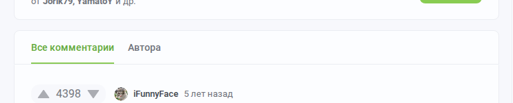 | 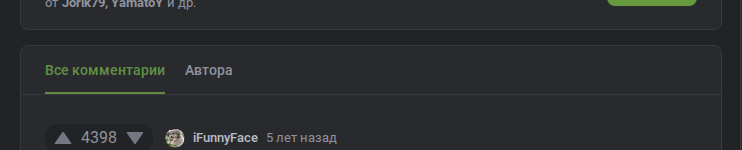 |

### 4.2 Current Userscript (`v0.1.8`) Top Bar — Idle (`79px`, Wrapped Buttons, Floating Underline)

| Light Theme                                                                   | Dark Theme (`data-theme-dark`)                                              |
| ----------------------------------------------------------------------------- | --------------------------------------------------------------------------- |
| 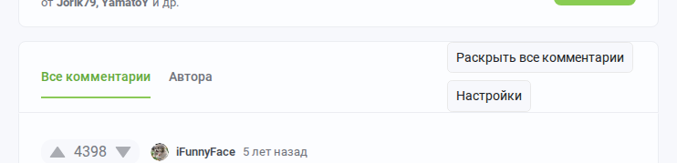 | 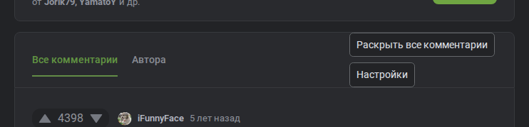 |

### 4.3 Current Userscript (`v0.1.8`) Top Bar — Settings Open (`88.5px`, `+9.5px` Shift & Width Jump)

| Light Theme                                                                                     | Dark Theme (`data-theme-dark`)                                                                |
| ----------------------------------------------------------------------------------------------- | --------------------------------------------------------------------------------------------- |
| 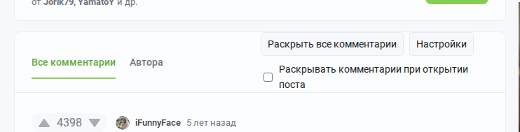 | 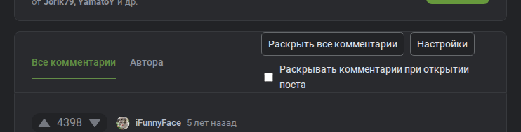 |

### 4.4 Current Userscript (`v0.1.8`) Top Bar — Running (`88.5px`, 2-Line Status Wrap)

| Light Theme                                                                         | Dark Theme (`data-theme-dark`)                                                    |
| ----------------------------------------------------------------------------------- | --------------------------------------------------------------------------------- |
| 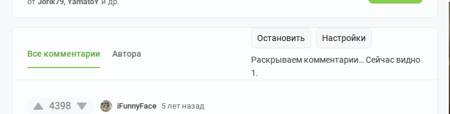 | 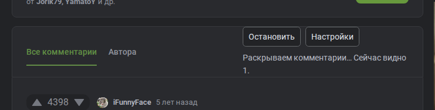 |

### 4.5 Bottom Comments Area — With `.comment__more` Visible (`poputchik_7957162`)

| Light Theme                                                                      | Dark Theme (`data-theme-dark`)                                                 |
| -------------------------------------------------------------------------------- | ------------------------------------------------------------------------------ |
| 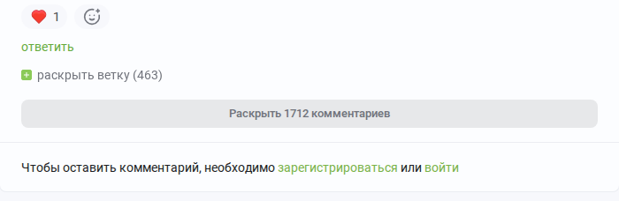 | 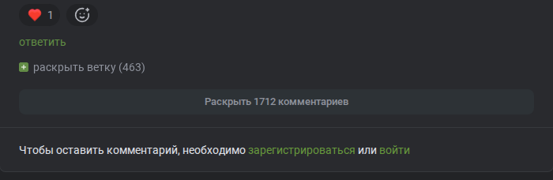 |

### 4.6 Bottom Comments Area — After All Comment Batches Expanded, `.comment__more` Removed (`memoterapiya_14551680`)

| Light Theme                                                                        | Dark Theme (`data-theme-dark`)                                                   |
| ---------------------------------------------------------------------------------- | -------------------------------------------------------------------------------- |
| 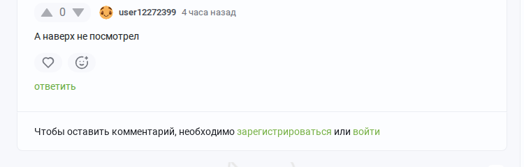 | 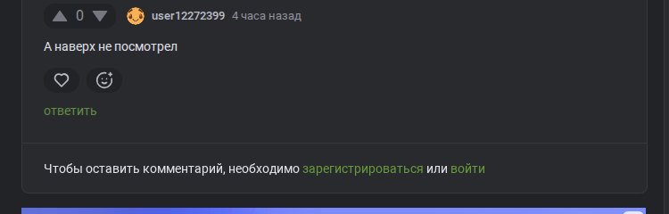 |
